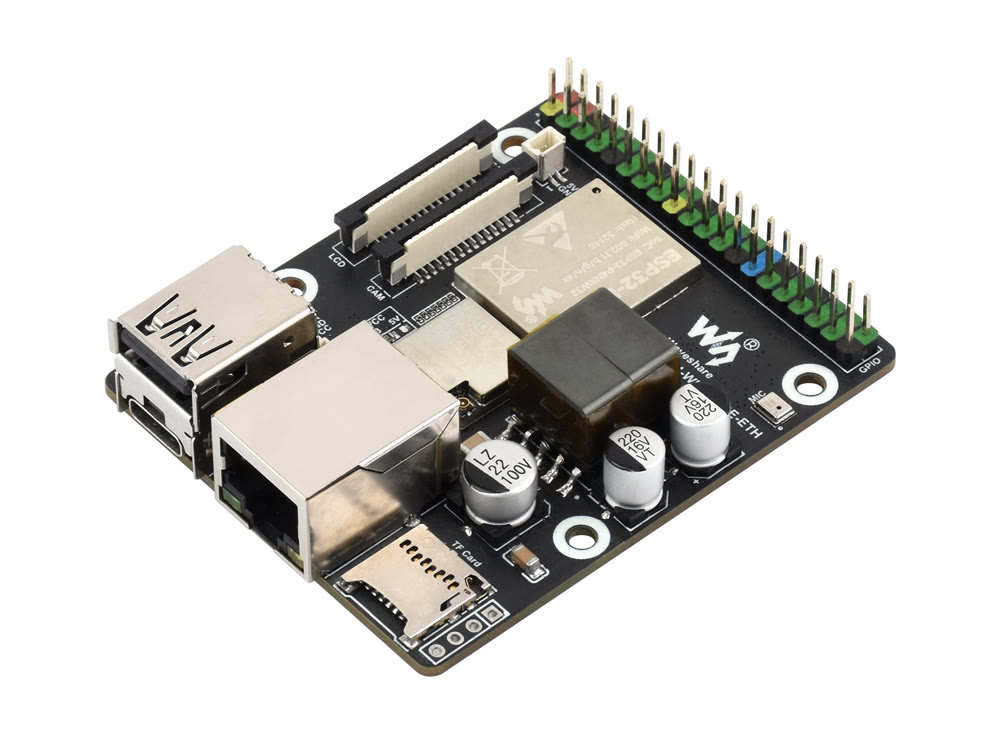

  <h1>ESP32-P4-WIFI6-DB-POE-ETH</h1>
  
<strong>ESP32-P4 and ESP32-C5 Wi-Fi 6 development board with PoE Ethernet</strong>

  
<strong>English</strong> | <a href="README_ZH.md">简体中文</a>

  

    
    
    
  

  

    <a href="https://www.waveshare.net/shop/ESP32-P4-WIFI6-DB-POE-ETH.htm">🛒 Product</a> ·
    <a href="https://github.com/waveshareteam/ESP32-P4-WIFI6-DB-POE-ETH/releases/latest">📦 Firmware</a> ·
    <a href="examples/esp-idf/">🧩 ESP-IDF</a> ·
    <a href="examples/arduino/examples/">🔧 Arduino</a> ·
    <a href="https://docs.waveshare.com/ESP32-P4-WIFI6-DB-POE-ETH/">📖 Documentation</a>
  

  

---

## ✨ Overview

**ESP32-P4-WIFI6-DB-POE-ETH** is a development board built around the ESP32-P4NRW32X processor and an ESP32-C5 Wi-Fi 6 / Bluetooth LE wireless coprocessor over SDIO. It integrates RMII Ethernet with an IEEE 802.3af PoE module, 2-lane MIPI-DSI display and GT911 touch, 2-lane MIPI-CSI camera, ES8311 audio, microSD, USB 2.0 Host, and a 40-pin GPIO header.

This repository provides ESP-IDF examples, Arduino examples with a local board definition, the ESP-Brookesia factory firmware source, and ESP32-C5 coprocessor firmware. Run [00_board_check](examples/esp-idf/00_board_check/) first to verify building, flashing, and serial monitoring.

| Feature | Device / interface |
| --- | --- |
| MCU | ESP32-P4NRW32X (dual-core RISC-V HP + LP core) |
| Wireless | ESP32-C5 wireless coprocessor (Wi-Fi 6 & BLE, 4-bit SDIO) |
| Memory | On-board 32 MB Flash and 32 MB PSRAM |
| Ethernet | 10/100M RMII interface (IP101 PHY) with integrated IEEE 802.3af PoE module |
| Display | 2-lane MIPI-DSI interface with I2C backlight control (supports [5-DSI-TOUCH-A](https://www.waveshare.com/5-DSI-TOUCH-A.htm), [7-DSI-TOUCH-A](https://www.waveshare.com/7-DSI-TOUCH-A.htm), [8-DSI-TOUCH-A](https://www.waveshare.com/8-DSI-TOUCH-A.htm), [10.1-DSI-TOUCH-A](https://www.waveshare.com/10.1-DSI-TOUCH-A.htm)) |
| Touch | GT911 capacitive touch (I2C interface) |
| Camera | On-board 2-lane MIPI-CSI interface supporting OV5647 ([RPi Camera (B)](https://www.waveshare.com/rpi-camera-b.htm)) camera module |
| Audio | ES8311 audio codec (I2C + I2S) with speaker amplifier and analog microphone input |
| Storage | On-board microSD slot over 4-bit SDMMC |
| USB | USB 2.0 Host (internal USB PHY, over-current protection) |
| Expansion | 40-pin GPIO header (28 GPIOs), UART0 debug interface |

## 📦 Quick Start

The fastest way to try an example is to flash a packaged firmware from the [latest release](https://github.com/waveshareteam/ESP32-P4-WIFI6-DB-POE-ETH/releases/latest).

1. Download the `*-combined.zip` for the example and framework version you want.
2. Extract the archive and install esptool with `python -m pip install esptool`.
3. Connect the board over USB.
4. Run `flash_combined.bat COMx` on Windows or `./flash_combined.sh /dev/ttyACM0` on Linux.
5. Reset the board if it does not restart automatically.

Factory & coprocessor firmware: download the `Factory` image for your display model or the ESP32-C5 coprocessor firmware (required before running Wi-Fi or Bluetooth examples) from [`firmware`](firmware/); ESP-Brookesia factory source is in [`examples/factory`](examples/factory/).

## 🧪 Examples

### ESP-IDF

| Example | Description |
| --- | --- |
| [00_board_check](examples/esp-idf/00_board_check/) | Recommended first example; prints chip, flash, and PSRAM information over serial |
| [01_i2c_tools](examples/esp-idf/01_i2c_tools/) | I2C bus scan and diagnostic console |
| [02_sdmmc](examples/esp-idf/02_sdmmc/) | microSD card access over 4-bit SDMMC |
| [03_wifi_sta](examples/esp-idf/03_wifi_sta/) | Connects to a Wi-Fi station through the ESP32-C5 `esp_hosted` link |
| [04_i2s_es8311](examples/esp-idf/04_i2s_es8311/) | ES8311 audio playback, I2S loopback, and recording |
| [05_nvs_rw_value](examples/esp-idf/05_nvs_rw_value/) | NVS read/write example with a persistent boot counter |
| [06_eth2ap](examples/esp-idf/06_eth2ap/) | Ethernet-to-Wi-Fi access point bridge |
| [07_ethernet_basic](examples/esp-idf/07_ethernet_basic/) | Basic RMII Ethernet bring-up with `esp_netif` |
| [08_mipi_dsi](examples/esp-idf/08_mipi_dsi/) | Basic MIPI-DSI display test using color bars |
| [09_lvgl](examples/esp-idf/09_lvgl/) | LVGL benchmark on the MIPI-DSI panel |
| [10_mipi_csi](examples/esp-idf/10_mipi_csi/) | Displays the MIPI-CSI camera feed on the LCD via `esp_video` and PPA |
| [11_usb_extend_screen](examples/esp-idf/11_usb_extend_screen/) | USB extended-display example |
| [12_generic_gpio](examples/esp-idf/12_generic_gpio/) | LVGL grid for viewing and toggling expansion-header GPIO levels |
| [13_ethernet_iperf](examples/esp-idf/13_ethernet_iperf/) | Ethernet TCP/UDP throughput test with an iPerf 2.x PC peer |
| [14_bleprph_gatt](examples/esp-idf/14_bleprph_gatt/) | NimBLE peripheral with a custom read/write and notification GATT service through the ESP32-C5 BLE controller over ESP-Hosted HCI |

### Hardware Console

[15_hw_console](examples/esp-idf/15_hw_console/README.md) is an interactive serial console for operating the board's peripherals. Run `idf.py bmgr` before building it.

### Arduino

Follow the [board definition installation guide](examples/arduino/libraries/board_config/README.md), then open a sketch in Arduino IDE.

| Example | Description |
| --- | --- |
| [board_check](examples/arduino/examples/board_check/) | Displays chip, flash, PSRAM, and memory information |
| [gpio](examples/arduino/examples/gpio/) | Interactive GPIO test over serial |
| [i2c](examples/arduino/examples/i2c/) | Scans the board's I2C1 bus |
| [i2s](examples/arduino/examples/i2s/) | ES8311 microphone-to-speaker audio loopback |
| [sdmmc](examples/arduino/examples/sdmmc/) | microSD card read/write test |
| [mipi_dsi](examples/arduino/examples/mipi_dsi/) | MIPI-DSI color-bar and backlight test |
| [mipi_csi](examples/arduino/examples/mipi_csi/) | Displays video from an OV5647 camera on the LCD |

## 🛠️ Development Environment

| Framework | Version | Examples |
| --- | --- | ---: |
| ESP-IDF | `v5.5.6`, `v6.1` | 16 |
| Arduino-ESP32 | `3.3.11` | 7 |

## 📚 Resources

- [Schematic](hardware/schematic/)
- [Hardware guide](docs/hw-reference/user-guide.md)
- [Product page](https://www.waveshare.net/shop/ESP32-P4-WIFI6-DB-POE-ETH.htm)
- [Wiki](https://docs.waveshare.com/ESP32-P4-WIFI6-DB-POE-ETH/)

## 🤝 Support

- Example or repository problem: [open an issue](https://github.com/waveshareteam/ESP32-P4-WIFI6-DB-POE-ETH/issues/new/choose).
- Product usage, hardware or order questions: [Waveshare support](https://service.waveshare.com/).

## 📄 License

Apache License 2.0. See [LICENSE](LICENSE).
