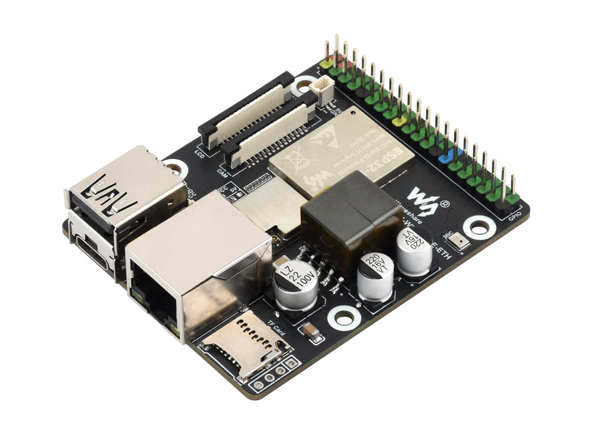

  <h1>ESP32-P4-WIFI6-DB-POE-ETH</h1>
  
<strong>搭载 ESP32-P4 和 ESP32-C5 的 Wi-Fi 6 开发板，集成 PoE 以太网</strong>

  
<a href="README.md">English</a> | <strong>简体中文</strong>

  

    
    
    
  

  

    <a href="https://www.waveshare.net/shop/ESP32-P4-WIFI6-DB-POE-ETH.htm">🛒 产品</a> ·
    <a href="https://github.com/waveshareteam/ESP32-P4-WIFI6-DB-POE-ETH/releases/latest">📦 固件</a> ·
    <a href="examples/esp-idf/">🧩 ESP-IDF</a> ·
    <a href="examples/arduino/examples/">🔧 Arduino</a> ·
    <a href="https://docs.waveshare.net/ESP32-P4-WIFI6-DB-POE-ETH/">📖 文档</a>
  

  

---

## ✨ 概述

**ESP32-P4-WIFI6-DB-POE-ETH** 是一款基于 ESP32-P4NRW32X 处理器与 ESP32-C5 Wi-Fi 6 / BLE 无线协处理器的开发板，集成支持 IEEE 802.3af PoE 模块的 RMII 以太网、双 lane MIPI-DSI 显示与 GT911 触摸、双 lane MIPI-CSI 摄像头、ES8311 音频编解码、microSD 卡槽、USB 2.0 Host 及 40 针 GPIO 排针。

本仓库提供配套的 ESP-IDF 示例、包含本地板卡定义的 Arduino 示例、ESP-Brookesia 出厂固件源码以及 ESP32-C5 协处理器固件。建议先运行 [00_board_check](examples/esp-idf/00_board_check/) 示例，确认编译、烧录与串口监视流程正常。

| 功能 | 器件或接口 |
| --- | --- |
| MCU | ESP32-P4NRW32X（双核高性能 RISC-V + 低功耗核） |
| 无线连接 | ESP32-C5 无线协处理器（支持 Wi-Fi 6 & BLE，4-bit SDIO） |
| 存储器 | 板载 32 MB Flash 与 32 MB PSRAM |
| 以太网 | 10/100M RMII 接口（IP101 PHY），集成 IEEE 802.3af PoE 模块 |
| 显示接口 | 双 lane MIPI-DSI 接口，I2C 背光控制（支持 [5-DSI-TOUCH-A](https://www.waveshare.net/shop/5-DSI-TOUCH-A.htm)、[7-DSI-TOUCH-A](https://www.waveshare.net/shop/7-DSI-TOUCH-A.htm)、[8-DSI-TOUCH-A](https://www.waveshare.net/shop/8-DSI-TOUCH-A.htm)、[10.1-DSI-TOUCH-A](https://www.waveshare.net/shop/10.1-DSI-TOUCH-A.htm)） |
| 触摸 | GT911 电容触摸（I2C 接口） |
| 摄像头 | 板载双 lane MIPI-CSI 接口，支持 OV5647（[RPi Camera (B)](https://www.waveshare.net/shop/RPi-Camera-B.htm)）摄像头模组 |
| 音频 | ES8311 音频编解码芯片（I2C + I2S），支持扬声器功放与模拟麦克风输入 |
| 扩展存储 | 板载 microSD 卡槽，通过 4-bit SDMMC 接口高速读写 |
| USB | USB 2.0 Host（内置 USB PHY，带过流保护） |
| 扩展接口 | 40 针 GPIO 排针（引出 28 个 GPIO）、UART0 调试接口 |

## 📦 快速开始

体验示例最快的方法是使用[最新版本](https://github.com/waveshareteam/ESP32-P4-WIFI6-DB-POE-ETH/releases/latest)中打包好的可烧录固件。

1. 下载所需示例和框架版本对应的 `*-combined.zip`。
2. 解压后通过 `python -m pip install esptool` 安装 esptool。
3. 通过 USB 连接开发板。
4. Windows 运行 `flash_combined.bat COMx`，Linux 运行 `./flash_combined.sh /dev/ttyACM0`。
5. 如果开发板未自动重启，请手动复位。

出厂与协处理器固件：ESP-Brookesia 出厂固件源码见 [`examples/factory`](examples/factory/)；不同屏幕尺寸对应的 `FactoryOnly` 出厂固件与 ESP32-C5 协处理器固件二进制及烧录说明见 [`firmware`](firmware/) 目录（运行 Wi-Fi / 蓝牙等无线示例前需先烧录 C5 固件）。

## 🧪 示例

### ESP-IDF

| 示例 | 说明 |
| --- | --- |
| [00_board_check](examples/esp-idf/00_board_check/) | 首个建议运行的示例，串口打印芯片、Flash、PSRAM 信息 |
| [01_i2c_tools](examples/esp-idf/01_i2c_tools/) | I2C 总线扫描与诊断控制台工具 |
| [02_sdmmc](examples/esp-idf/02_sdmmc/) | microSD 卡的 4-bit SDMMC 读写访问 |
| [03_wifi_sta](examples/esp-idf/03_wifi_sta/) | 通过 ESP32-C5 `esp_hosted` 链路连接 Wi-Fi station |
| [04_i2s_es8311](examples/esp-idf/04_i2s_es8311/) | ES8311 音频播放，以及 I2S 回声/录音 |
| [05_nvs_rw_value](examples/esp-idf/05_nvs_rw_value/) | NVS 读写示例，持久化开机计数器 |
| [06_eth2ap](examples/esp-idf/06_eth2ap/) | 以太网转 Wi-Fi AP 桥接 |
| [07_ethernet_basic](examples/esp-idf/07_ethernet_basic/) | 基于 `esp_netif` 的 RMII 以太网基础示例 |
| [08_mipi_dsi](examples/esp-idf/08_mipi_dsi/) | 最简单的 MIPI-DSI 显示点亮示例：彩条测试图案 |
| [09_lvgl](examples/esp-idf/09_lvgl/) | MIPI-DSI 屏幕上的 LVGL 性能测试演示 |
| [10_mipi_csi](examples/esp-idf/10_mipi_csi/) | 通过 `esp_video` 和 PPA 将 MIPI-CSI 摄像头画面显示到 LCD |
| [11_usb_extend_screen](examples/esp-idf/11_usb_extend_screen/) | USB 扩展屏示例 |
| [12_generic_gpio](examples/esp-idf/12_generic_gpio/) | LVGL 网格界面，实时显示/切换扩展排针 GPIO 电平 |
| [13_ethernet_iperf](examples/esp-idf/13_ethernet_iperf/) | 使用 PC 端 iPerf 2.x 测量以太网 TCP/UDP 吞吐 |
| [14_bleprph_gatt](examples/esp-idf/14_bleprph_gatt/) | 通过 ESP-Hosted HCI 使用 ESP32-C5 BLE 控制器的 NimBLE 外设，提供自定义读写及通知 GATT 服务 |

### 硬件控制台

[15_hw_console](examples/esp-idf/15_hw_console/README_ZH.md) 是通过串口命令操作开发板外设的交互式控制台，编译前需要先运行 `idf.py bmgr`。

### Arduino

按[板卡定义安装说明](examples/arduino/libraries/board_config/README.md)配置 Arduino IDE，再打开示例。

| 示例 | 说明 |
| --- | --- |
| [board_check](examples/arduino/examples/board_check/) | 查看芯片、Flash、PSRAM 和内存信息 |
| [gpio](examples/arduino/examples/gpio/) | 通过串口交互测试 GPIO |
| [i2c](examples/arduino/examples/i2c/) | 扫描开发板 I2C1 总线 |
| [i2s](examples/arduino/examples/i2s/) | ES8311 麦克风到扬声器的音频回环 |
| [sdmmc](examples/arduino/examples/sdmmc/) | microSD 卡读写 |
| [mipi_dsi](examples/arduino/examples/mipi_dsi/) | MIPI-DSI 屏幕色条和背光测试 |
| [mipi_csi](examples/arduino/examples/mipi_csi/) | 将 OV5647 摄像头画面显示到 LCD |

## 🛠️ 开发环境

| 开发框架 | 版本 | 示例数 |
| --- | --- | ---: |
| ESP-IDF | `v5.5.6`、`v6.1` | 16 |
| Arduino-ESP32 | `3.3.11` | 7 |

## 📚 资料

- [原理图](hardware/schematic/)
- [硬件参考指南](docs/hw-reference/user-guide_ZH.md)
- [产品页面](https://www.waveshare.net/shop/ESP32-P4-WIFI6-DB-POE-ETH.htm)
- [Wiki](https://docs.waveshare.net/ESP32-P4-WIFI6-DB-POE-ETH/)

## 🤝 支持

- [反馈示例或仓库问题](https://gitee.com/waveshare/ESP32-P4-WIFI6-DB-POE-ETH/issues)
- [微雪技术支持](https://docs.waveshare.net/ESP32-P4-WIFI6-DB-POE-ETH/Technical-Support/)

## 📄 许可证

Apache License 2.0，详见 [LICENSE](LICENSE)。
