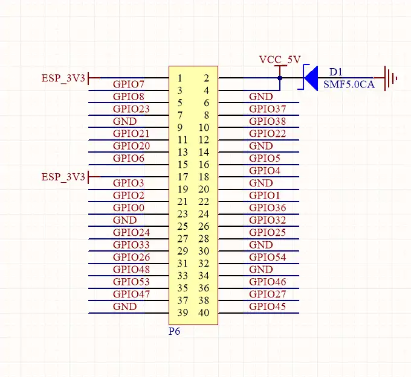
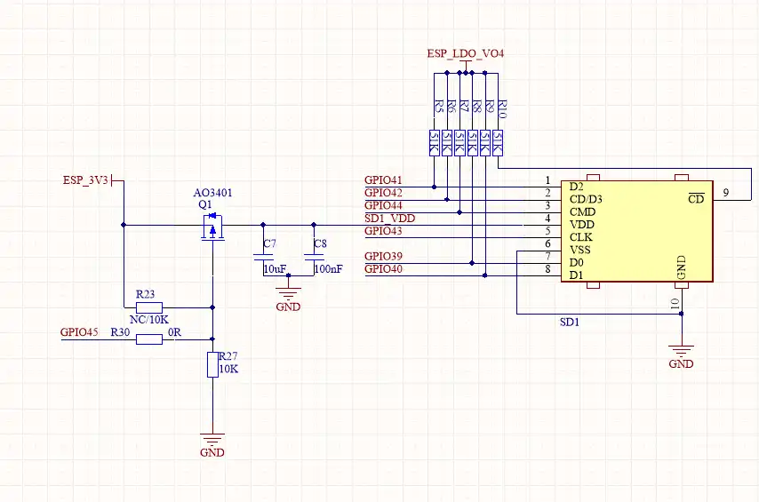

# ESP32-P4-WIFI6-DB-POE-ETH <!-- omit in toc -->

[Simplified Chinese](../../zh_CN/hw-reference/user-guide.md)

This user guide will help you get started with ESP32-P4-WIFI6-DB-POE-ETH and will also provide more in-depth information.

ESP32-P4-WIFI6-DB-POE-ETH is a development board built around the ESP32-P4NRW32X processor, paired with an ESP32-C5 wireless coprocessor over SDIO. It provides RMII Ethernet with an integrated PoE module, a two-lane MIPI-DSI display and touch interface, a two-lane MIPI-CSI camera interface, ES8311 audio, microSD, USB Host and a 40-pin GPIO header.

The document consists of the following major sections:

- [Getting Started](#1-getting-started): Overview of the board, its onboard resources, peripherals and factory firmware.
- [Start Application Development](#2-start-application-development): Hardware and software setup before development.
- [Hardware Reference](#3-hardware-reference): GPIO allocation, GPIO header, connectors and usage notes.
- [Related Documents](#4-related-documents): Links to related documentation.

# 1. Getting Started

## 1.1. Overview

The ESP32-P4NRW32X main processor handles the display, camera, audio, storage, Ethernet and USB interfaces. The ESP32-C5 acts as a wireless coprocessor and provides Wi-Fi 6 and Bluetooth LE to the ESP32-P4 through ESP-Hosted (SDIO). The ESP32-P4 has no integrated Wi-Fi or Bluetooth, so wireless features require the P4 application and the C5 coprocessor firmware to run together.

## 1.2. Onboard Resources

The table below lists the key components of the board.

<details open>
<summary><b>Onboard resources table</b></summary>

| Key Component | Description |
| --- | --- |
| Main processor | ESP32-P4NRW32X — dual-core high-performance RISC-V system and a low-power core, with package-integrated PSRAM at 200 MHz. |
| Flash | 32 MB, QIO mode. |
| Wireless coprocessor | ESP32-C5, supporting Wi-Fi 6 and Bluetooth LE, connected to the ESP32-P4 over four-bit SDIO. ESP32-P4 GPIO54 resets the ESP32-C5 (active low); GPIO6 can be used as its wake-up signal. |
| Ethernet | RMII MAC with IP101 PHY at PHY address 1 and a 50 MHz external REF_CLK input. The integrated PoE module powers the board from an IEEE 802.3af PoE router or switch. |
| Display | Two-lane MIPI-DSI for external Waveshare panels (see [Display and Camera Connectors](#33-display-and-camera-connectors)). The LCD reset pin is not connected; the backlight is controlled over I2C. |
| Touch | GT911 capacitive touch on the shared GPIO7/GPIO8 I2C bus; reset and interrupt are not connected, so touch status is read by polling. |
| Audio | ES8311 codec over I2C + I2S with MCLK on GPIO13; speaker output through an amplifier enabled by GPIO53; one analog microphone input. |
| Storage | microSD slot over four-bit SDMMC; card power switched by GPIO45 (active low). |
| Camera | Two-lane MIPI-CSI connector with SCCB on the shared I2C bus; OV5647 ([RPi Camera (B)](https://www.waveshare.com/rpi-camera-b.htm)) and SC2336 sensors are supported. XCLK and RESET are not connected to ESP32-P4 GPIOs. |
| USB | USB 2.0 Host on the ESP32-P4 internal USB PHY (DM/DP), with over-current protection. |
| UART0 | Firmware download and serial logs on GPIO37 (TX) / GPIO38 (RX). |
| GPIO header | 40-pin header P6 (see [GPIO Header (P6)](#32-gpio-header-p6)), exposing 28 ESP32-P4 GPIOs plus 3.3 V, 5 V and ground; some GPIOs are shared with onboard functions. |
| 32.768 kHz crystal | On GPIO0/GPIO1 (XTAL_32K_N/P), provides the ESP32-P4 RTC slow clock. |

</details>

## 1.3. Peripheral Quick Reference

<details open>
<summary><b>Peripheral quick reference table</b></summary>

| Module | Device / Function | Interface | Address / Parameters | GPIO / Signal |
| --- | --- | --- | --- | --- |
| LCD | MIPI-DSI panel | MIPI-DSI | 2-lane; HX8394 / ILI9881C / JD9365 | LCD reset not connected |
| LCD backlight | Backlight controller | I2C | 7-bit address 0x45 | SDA=GPIO7, SCL=GPIO8 |
| Touch | GT911 capacitive touch | I2C | 7-bit address 0x5D or 0x14 | SDA=GPIO7, SCL=GPIO8; RST/INT not connected |
| Camera | MIPI-CSI camera connector | MIPI-CSI + SCCB | 2-lane; OV5647 / SC2336 | SCCB shares GPIO7/8; XCLK/RESET not connected |
| Audio | ES8311 codec | I2C + I2S | 7-bit address 0x18 | SDA=7, SCL=8; MCLK=13, SCLK=12, WS=10, DOUT=9, DIN=11 |
| Power amp | Speaker amplifier enable | GPIO | Active high | GPIO53 |
| microSD | microSD slot | SDMMC 4-bit | — | CLK=43, CMD=44, D0–D3=39–42; power enable=45, active low |
| Ethernet | IP101 PHY | RMII + SMI | PHY address 1; 50 MHz REF_CLK input | CRS_DV=28, RXD0=29, RXD1=30, TXD0=34, TXD1=35, TX_EN=49, REF_CLK=50; MDC=31, MDIO=52; PHY reset=51 |
| Wi-Fi/BT coprocessor | ESP32-C5 | SDIO 4-bit | 40 MHz | CLK=18, CMD=19, D0–D3=14–17; reset=54 (active low); wake-up=6 |
| USB | USB 2.0 Host | USB | Internal USB PHY, over-current protection | Dedicated DM/DP pins |
| UART0 | Programming and serial logs | UART | — | TX=GPIO37, RX=GPIO38 |

</details>

## 1.4. Factory Firmware

The board's ESP-Brookesia based application firmware features display, touch, audio, camera, video, Wi-Fi, Ethernet and XiaoZhi. For the feature overview, usage and build instructions, see the [Brookesia firmware README](../../../firmware/brookesia/README.md). A serial-console firmware that tests all board hardware is described in the [factory test README](../../../firmware/factory_test/README.md).

# 2. Start Application Development

This section describes the hardware you need and the hardware and software setup before development.

## 2.1. Required Hardware

- 1 x ESP32-P4-WIFI6-DB-POE-ETH
- 1 x USB cable for power, firmware download and serial logs
- 1 x Computer running Windows, Linux or macOS

## 2.2. Optional Hardware

- 1 x Waveshare MIPI-DSI touch panel: [5-DSI-TOUCH-A](https://www.waveshare.com/5-dsi-touch-a.htm), [7-DSI-TOUCH-A](https://www.waveshare.com/7-dsi-touch-a.htm), [8-DSI-TOUCH-A](https://www.waveshare.com/8-dsi-touch-a.htm) or [10.1-DSI-TOUCH-A](https://www.waveshare.com/10.1-dsi-touch-a.htm)
- 1 x MIPI-CSI camera module (OV5647, such as [RPi Camera (B)](https://www.waveshare.com/rpi-camera-b.htm), or SC2336)
- 1 x microSD card
- 1 x Speaker
- 1 x Ethernet cable, and an IEEE 802.3af PoE router or switch to power the board over PoE

## 2.3. Power Supply Options

The board can be powered in either of the following ways:

- USB port
- PoE through the Ethernet port, from a router or switch that supports IEEE 802.3af

> **Note**
>
> Firmware cannot tell whether the board runs on PoE. When validating PoE, run the test again with the board powered only over PoE.

## 2.4. Hardware Setup

1. Connect the board's download/serial port to your computer with a USB cable.
2. If you use a display or camera, connect the cable with power off and verify connector orientation against the module instructions.
3. If you use Ethernet, connect the cable to a network with a DHCP server; for PoE, use an IEEE 802.3af port.
4. If automatic download fails, put the board into download mode manually before flashing.

## 2.5. Software Setup

1. Install ESP-IDF. The local BSP requires ESP-IDF >= 5.5.
2. Build and flash the board check example [00_board_check](../../../examples/esp-idf/00_board_check/):

   ```bash
   cd examples/esp-idf/00_board_check
   idf.py set-target esp32p4
   idf.py build
   idf.py -p PORT flash monitor
   ```

   Replace `PORT` with the actual serial port, for example `COM7` on Windows or `/dev/ttyACM0` on Linux.

3. Once the board check passes, continue with the [ESP-IDF examples](../../../examples/esp-idf/) or [Arduino examples](../../../examples/Arduino/).

# 3. Hardware Reference

This section provides more detailed information about the board hardware.

## 3.1. GPIO Allocation

The table lists every GPIO (0–54) and its board connection.

<details open>
<summary><b>GPIO allocation table (GPIO0–GPIO54)</b></summary>

| GPIO | Signal | Connected To | Notes |
| --- | --- | --- | --- |
| GPIO0 | XTAL_32K_N | 32.768 kHz crystal / Header P6-23 | Account for the crystal circuit before using it for another purpose |
| GPIO1 | XTAL_32K_P | 32.768 kHz crystal / Header P6-22 | Account for the crystal circuit before using it for another purpose |
| GPIO2 | GPIO2 | Header P6-21 | Configurable as general-purpose GPIO |
| GPIO3 | GPIO3 | Header P6-19 | Configurable as general-purpose GPIO |
| GPIO4 | GPIO4 | Header P6-18 | Configurable as general-purpose GPIO |
| GPIO5 | GPIO5 | Header P6-16 | Configurable as general-purpose GPIO |
| GPIO6 | C5_WAKEUP | ESP32-C5 / Header P6-15 | Can be used as the ESP32-C5 wake-up signal |
| GPIO7 | I2C SDA | ES8311, GT911, LCD backlight controller, camera SCCB / Header P6-3 | Shared I2C bus |
| GPIO8 | I2C SCL | ES8311, GT911, LCD backlight controller, camera SCCB / Header P6-5 | Shared I2C bus |
| GPIO9 | I2S DOUT | ES8311 DSDIN | Playback data, ESP32-P4 → codec |
| GPIO10 | I2S WS | ES8311 LRCK | Audio frame sync |
| GPIO11 | I2S DIN | ES8311 ASDOUT | Capture data, codec → ESP32-P4 |
| GPIO12 | I2S SCLK | ES8311 SCLK | Audio bit clock |
| GPIO13 | I2S MCLK | ES8311 MCLK | Audio master clock |
| GPIO14 | SDIO D0 | ESP32-C5 | SDIO data line |
| GPIO15 | SDIO D1 | ESP32-C5 | SDIO data line |
| GPIO16 | SDIO D2 | ESP32-C5 | SDIO data line |
| GPIO17 | SDIO D3 | ESP32-C5 | SDIO data line |
| GPIO18 | SDIO CLK | ESP32-C5 | SDIO clock |
| GPIO19 | SDIO CMD | ESP32-C5 | SDIO command |
| GPIO20 | GPIO20 | Header P6-13 | Configurable as general-purpose GPIO |
| GPIO21 | GPIO21 | Header P6-11 | Configurable as general-purpose GPIO |
| GPIO22 | GPIO22 | Header P6-12 | Configurable as general-purpose GPIO |
| GPIO23 | GPIO23 | Header P6-7 | Configurable as general-purpose GPIO |
| GPIO24 | GPIO24 | Header P6-27 | Configurable as general-purpose GPIO |
| GPIO25 | GPIO25 | Header P6-28 | Configurable as general-purpose GPIO |
| GPIO26 | GPIO26 | Header P6-31 | Configurable as general-purpose GPIO |
| GPIO27 | GPIO27 | Header P6-38 | Configurable as general-purpose GPIO |
| GPIO28 | RMII CRS_DV | Ethernet PHY | Carrier sense / RX data valid, PHY → ESP32-P4 |
| GPIO29 | RMII RXD0 | Ethernet PHY | Receive data bit 0, PHY → ESP32-P4 |
| GPIO30 | RMII RXD1 | Ethernet PHY | Receive data bit 1, PHY → ESP32-P4 |
| GPIO31 | SMI MDC | Ethernet PHY | PHY management clock, ESP32-P4 → PHY |
| GPIO32 | GPIO32 | Header P6-26 | Configurable as general-purpose GPIO |
| GPIO33 | GPIO33 | Header P6-29 | Configurable as general-purpose GPIO |
| GPIO34 | RMII TXD0 | Ethernet PHY | Transmit data bit 0, ESP32-P4 → PHY; strapping pin |
| GPIO35 | RMII TXD1 | Ethernet PHY | Transmit data bit 1, ESP32-P4 → PHY; strapping pin |
| GPIO36 | GPIO36 | Header P6-24 | Configurable as general-purpose GPIO; strapping pin |
| GPIO37 | UART0 TX | Download / serial port / Header P6-8 | Firmware download and serial logs; strapping pin |
| GPIO38 | UART0 RX | Download / serial port / Header P6-10 | Firmware download and serial logs; strapping pin |
| GPIO39 | SD D0 | microSD card | SDMMC data line |
| GPIO40 | SD D1 | microSD card | SDMMC data line |
| GPIO41 | SD D2 | microSD card | SDMMC data line |
| GPIO42 | SD D3 | microSD card | SDMMC data line |
| GPIO43 | SD CLK | microSD card | SDMMC clock |
| GPIO44 | SD CMD | microSD card | SDMMC command |
| GPIO45 | SD_VDD_EN | microSD power switch / Header P6-40 | Active low; remove R30 to free it (see [microSD Power Control (R30)](#34-microsd-power-control-r30)) |
| GPIO46 | GPIO46 | Header P6-36 | Configurable as general-purpose GPIO |
| GPIO47 | GPIO47 | Header P6-37 | Configurable as general-purpose GPIO |
| GPIO48 | GPIO48 | Header P6-33 | Configurable as general-purpose GPIO |
| GPIO49 | RMII TX_EN | Ethernet PHY | Transmit enable, ESP32-P4 → PHY |
| GPIO50 | RMII REF_CLK | Ethernet PHY | 50 MHz reference clock, PHY → ESP32-P4 |
| GPIO51 | PHY_RST | Ethernet PHY | PHY hardware reset, ESP32-P4 → PHY |
| GPIO52 | SMI MDIO | Ethernet PHY | PHY management data, bidirectional |
| GPIO53 | PA_CTRL | Speaker amplifier / Header P6-35 | Active high |
| GPIO54 | C5_RST | ESP32-C5 reset / Header P6-32 | Low resets; high enables |

</details>

## 3.2. GPIO Header (P6)

P6 is a 40-pin header that exposes 28 ESP32-P4 GPIOs plus 3.3 V, 5 V and ground. The 5 V pins are protected by the SMF5.0CA TVS diode D1. Pins marked \* are shared with onboard functions; see [Usage Notes](#35-usage-notes) before connecting external circuits to them.

<details open>
<summary><b>P6 Header (40 Pins)</b></summary>

<table>
  <tr>
    <td valign="middle"></td>
    <td valign="middle">
      <table>
        <tr><th>Signal</th><th>Pin</th><th>Pin</th><th>Signal</th></tr>
        <tr><td>3V3</td><td align="center">1</td><td align="center">2</td><td>5V</td></tr>
        <tr><td>GPIO7 (I2C SDA)*</td><td align="center">3</td><td align="center">4</td><td>5V</td></tr>
        <tr><td>GPIO8 (I2C SCL)*</td><td align="center">5</td><td align="center">6</td><td>GND</td></tr>
        <tr><td>GPIO23</td><td align="center">7</td><td align="center">8</td><td>GPIO37 (UART0 TX)*</td></tr>
        <tr><td>GND</td><td align="center">9</td><td align="center">10</td><td>GPIO38 (UART0 RX)*</td></tr>
        <tr><td>GPIO21</td><td align="center">11</td><td align="center">12</td><td>GPIO22</td></tr>
        <tr><td>GPIO20</td><td align="center">13</td><td align="center">14</td><td>GND</td></tr>
        <tr><td>GPIO6 (C5 wake-up)*</td><td align="center">15</td><td align="center">16</td><td>GPIO5</td></tr>
        <tr><td>3V3</td><td align="center">17</td><td align="center">18</td><td>GPIO4</td></tr>
        <tr><td>GPIO3</td><td align="center">19</td><td align="center">20</td><td>GND</td></tr>
        <tr><td>GPIO2</td><td align="center">21</td><td align="center">22</td><td>GPIO1 (XTAL_32K_P)*</td></tr>
        <tr><td>GPIO0 (XTAL_32K_N)*</td><td align="center">23</td><td align="center">24</td><td>GPIO36</td></tr>
        <tr><td>GND</td><td align="center">25</td><td align="center">26</td><td>GPIO32</td></tr>
        <tr><td>GPIO24</td><td align="center">27</td><td align="center">28</td><td>GPIO25</td></tr>
        <tr><td>GPIO33</td><td align="center">29</td><td align="center">30</td><td>GND</td></tr>
        <tr><td>GPIO26</td><td align="center">31</td><td align="center">32</td><td>GPIO54 (C5 reset)*</td></tr>
        <tr><td>GPIO48</td><td align="center">33</td><td align="center">34</td><td>GND</td></tr>
        <tr><td>GPIO53 (PA enable)*</td><td align="center">35</td><td align="center">36</td><td>GPIO46</td></tr>
        <tr><td>GPIO47</td><td align="center">37</td><td align="center">38</td><td>GPIO27</td></tr>
        <tr><td>GND</td><td align="center">39</td><td align="center">40</td><td>GPIO45 (SD power)*</td></tr>
      </table>
    </td>
  </tr>
</table>

</details>

- Free GPIOs: GPIO2–5, GPIO20–27, GPIO32, GPIO33, GPIO36 and GPIO46–48.
- GPIO7/GPIO8 carry the onboard I2C bus; external I2C devices can be connected here as long as their addresses do not conflict.
- GPIO37/GPIO38 carry UART0 used for programming and logs.

## 3.3. Display and Camera Connectors

The camera SCCB interface, GT911 touch controller, LCD backlight controller and ES8311 share I2C on GPIO7/GPIO8.

| Connector | Interface | ESP32-P4 signals |
| --- | --- | --- |
| Display | MIPI-DSI | Two data lanes, clock lane, shared I2C for touch and backlight; LCD reset, touch reset and touch interrupt not connected |
| Camera | MIPI-CSI | Two data lanes, clock lane, shared I2C for SCCB; XCLK/RESET not connected |

Supported Waveshare panels. Select the one you connect with the BSP's LCD type option (`CONFIG_BSP_LCD_TYPE_*`) in `menuconfig`; the default is the 10.1-inch panel.

| Panel | Controller | Resolution |
| --- | --- | --- |
| [5-DSI-TOUCH-A](https://www.waveshare.com/5-dsi-touch-a.htm) | HX8394, 5-inch | 720 × 1280 |
| [7-DSI-TOUCH-A](https://www.waveshare.com/7-dsi-touch-a.htm) | ILI9881C, 7-inch | 720 × 1280 |
| [8-DSI-TOUCH-A](https://www.waveshare.com/8-dsi-touch-a.htm) | JD9365, 8-inch | 800 × 1280 |
| [10.1-DSI-TOUCH-A](https://www.waveshare.com/10.1-dsi-touch-a.htm) | JD9365, 10.1-inch | 800 × 1280 |

## 3.4. microSD Power Control (R30)

GPIO45 is shared between header pin P6-40 and the microSD power switch. It drives the gate of the P-MOSFET Q1 (AO3401) through R30 (0 Ω), and R27 (10 kΩ) pulls the gate to ground, so the card is powered while GPIO45 is low or floating and switched off when GPIO45 is high. If you do not need software control of the card power, remove R30 to free GPIO45.

<center>

|  |
|:--:|
| microSD power control circuit |

</center>

| Configuration | R30 | microSD power | GPIO45 |
| --- | --- | --- | --- |
| Default | 0 Ω | Switched by GPIO45: low on, high off | Used for card power; do not use as GPIO while the card is in use |
| GPIO45 as GPIO | Removed | Always on (gate held low by R27) | Free on P6-40 |

- With R30 removed, the card can no longer be power-cycled by software.
- The BSP still drives GPIO45 when it mounts and unmounts the card (it power-cycles the card on mount and drives GPIO45 high on unmount). If GPIO45 is used for another function, reconfigure it after mounting the card, or adapt the BSP.

## 3.5. Usage Notes

- The GPIO7/8 I2C bus already carries ES8311 (0x18), GT911 (0x5D/0x14), the LCD backlight controller (0x45) and camera SCCB; avoid address conflicts when adding external I2C devices.
- GPIO6, GPIO45, GPIO53 and GPIO54 carry control signals for onboard peripherals (ESP32-C5 wake-up, microSD power, speaker amplifier, ESP32-C5 reset); do not drive them independently while those peripherals are in use.
- GPIO28–GPIO31, GPIO34–GPIO35 and GPIO49–GPIO52 carry Ethernet RMII/SMI signals and the PHY reset; do not use them as general-purpose GPIOs.
- GPIO34–GPIO38 are ESP32-P4 strapping pins sampled at power-up and reset. GPIO34/35 also carry Ethernet TXD0/TXD1, GPIO36 is on header P6-24, and GPIO37/38 are used for programming and logs; make sure external circuits do not disturb their levels during sampling.
- GPIO0/GPIO1 are connected to the 32.768 kHz crystal; account for the crystal circuit before using them as general-purpose GPIOs.
- LCD reset, GT911 reset and GT911 interrupt are not connected; touch status is read over I2C by polling.
- Connect display/camera cables with power off and verify connector orientation against the module instructions.

# 4. Related Documents

## 4.1. Datasheets and Schematic

- [ESP32-P4-WIFI6-DB-POE-ETH Schematic](../../../hardware/ESP32-P4-WIFI6-DB-POE-ETH.pdf) (PDF)

- [ESP32-P4 Datasheet](https://www.espressif.com/sites/default/files/documentation/esp32-p4_datasheet_en.pdf) (PDF)
- [ESP32-C5 Datasheet](https://www.espressif.com/sites/default/files/documentation/esp32-c5_datasheet_en.pdf) (PDF)

## 4.2. Software Resources

- [BSP README](../../../components/esp32_p4_wifi6_db_poe_eth/README.md) and [API reference](../../../components/esp32_p4_wifi6_db_poe_eth/API.md)
- [Brookesia firmware](../../../firmware/brookesia/README.md)
- [Factory test firmware](../../../firmware/factory_test/README.md)
